# Tokenz

A native macOS menu bar app for Claude Code and Codex usage: each tool's plan limits at a glance, and the tokens you used today, this week and this month, read from the logs already on your Mac. Requires macOS 14 or later. Built with SwiftUI and AppKit; no third-party dependencies, no API keys, no network access.

Tokenz is an independent project, not affiliated with or endorsed by Anthropic or OpenAI. Claude, Claude Code, ChatGPT and Codex are trademarks of their owners.

<p align="center">
  <picture>
    <source media="(prefers-color-scheme: dark)" srcset="docs/assets/panel-dark.png">
    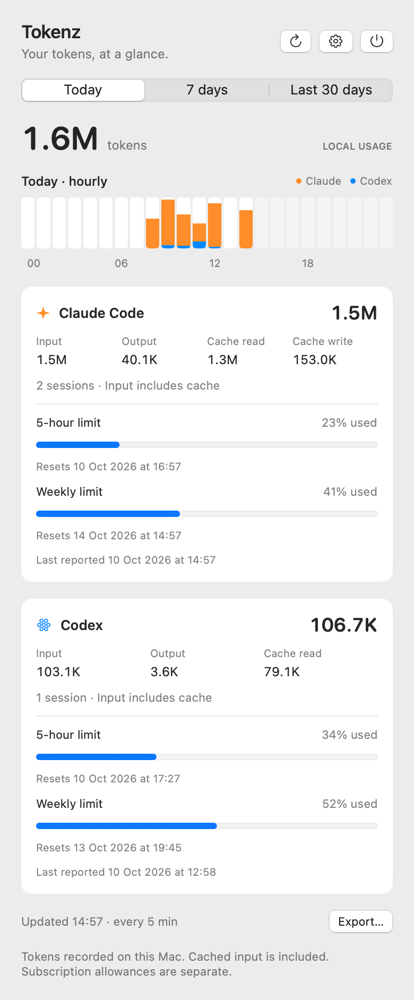
  </picture>
  <br><sub>All screenshots use demo data.</sub>
</p>

## Install

With Homebrew, from the first release:

```sh
brew install pardel/tap/tokenz
```

Or build from source (see [Develop](#develop)) and drag `dist/Tokenz.app` to Applications. The app has no Dock icon. Settings includes **Open at login**; macOS may ask for approval under System Settings → General → Login Items. Turn it on once the app is in its permanent location.

Claude plan percentages need a one-time step: see [Claude plan percentages](#claude-plan-percentages).

## Claude plan percentages

Codex reports its plan limits in its own session logs, so Tokenz needs no setup for them. Claude Code reports them only to a [status line](https://code.claude.com/docs/en/statusline) command, as a `rate_limits` object, so Tokenz needs a status line that saves it.

**In the app:** open Settings and choose **Set up…** under **Claude status line**; the Claude card offers the same button until a feed exists. If you have no status line yet, Tokenz asks before making two changes: it adds `tokenz-statusline.sh` to `~/.claude/`, and adds a `statusLine` entry to `~/.claude/settings.json`, after saving a copy as `settings.json.tokenz-backup`. The entry is inserted without reformatting the rest of the file. **Remove…** undoes both and keeps the backup and the saved percentages. Tokenz never replaces a status line you already have, and never changes a `settings.json` it cannot read.

<p align="center">
  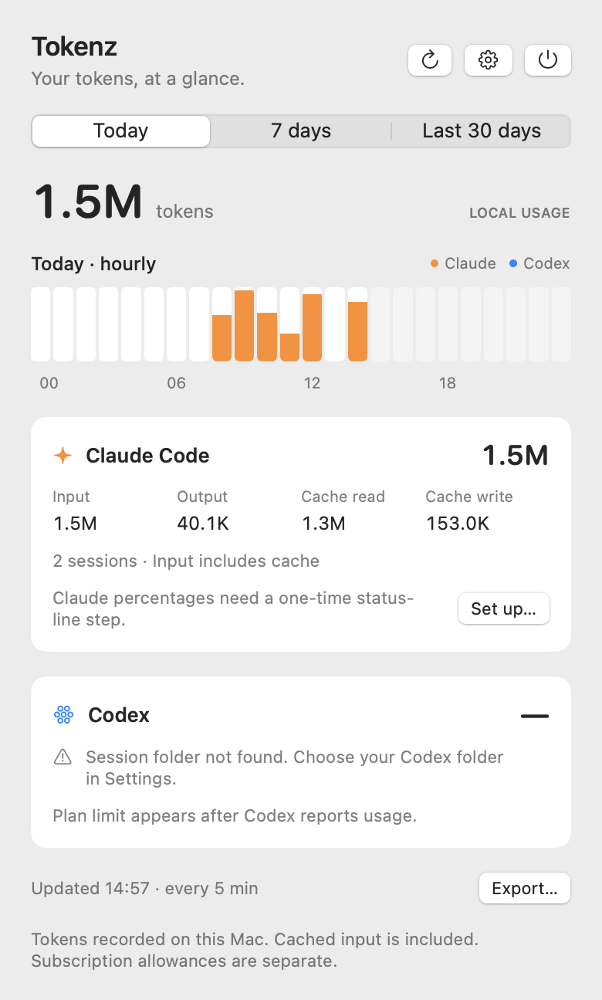
  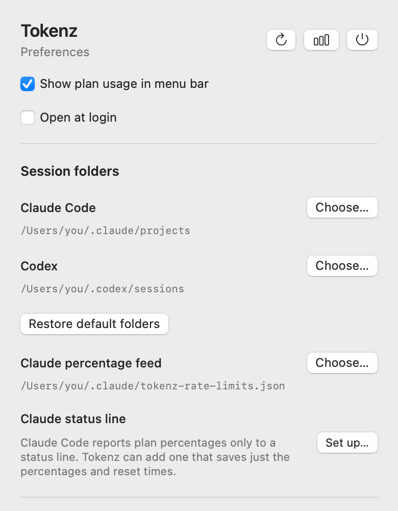
</p>

**With your own status line:** Settings shows the line to add to your script, after the script has read its input with `input=$(cat)`, and **Install script only…** adds the script without touching `settings.json`.

**By hand:**

1. Copy [`scripts/tokenz-statusline.sh`](scripts/tokenz-statusline.sh) to `~/.claude/` and make it executable (`chmod +x ~/.claude/tokenz-statusline.sh`).
2. Use it as your status line in `~/.claude/settings.json`:

   ```json
   "statusLine": { "type": "command", "command": "~/.claude/tokenz-statusline.sh" }
   ```

   If you already have a status line script, keep it and pass the script the same input from inside yours:

   ```sh
   printf '%s\n' "$input" | ~/.claude/tokenz-statusline.sh > /dev/null
   ```

The script saves only the percentages and reset times to `~/.claude/tokenz-rate-limits.json`, readable by you alone, and writes it atomically. Nothing else from the status line input (folders, transcript paths, costs) is kept. To use a different file, set `TOKENZ_FEED` for the script and choose the same file under **Settings → Claude percentage feed**.

Claude Code sends `rate_limits` only on Pro and Max plans, and only after a session's first response. Until then the Claude reading shows as unavailable, never as zero.

Every open session runs the status line, each with the limits from its own last response, so a session left idle can pass on older figures. Usage within a window only grows, so the script keeps the higher figure for the same window and never lets a window that has ended replace one that hasn't. An idle session's own status line can therefore show less than Tokenz until that session's next response.

<p align="center">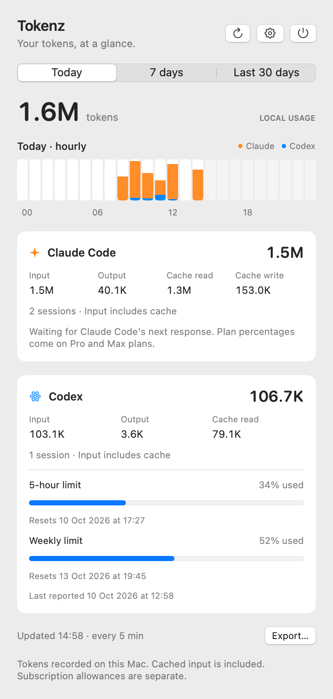</p>

## The menu bar

Each provider has a symbol, a **5-hour percentage** beside it and a **weekly usage underline** below: Claude (a sparkle) on the left, Codex (a hexagon grid) on the right. Each reading is coloured on its own: **green below 70%**, **orange from 70% to under 90%**, **red at 90% or above**. The symbol takes the colour of its weekly reading.

<p align="center">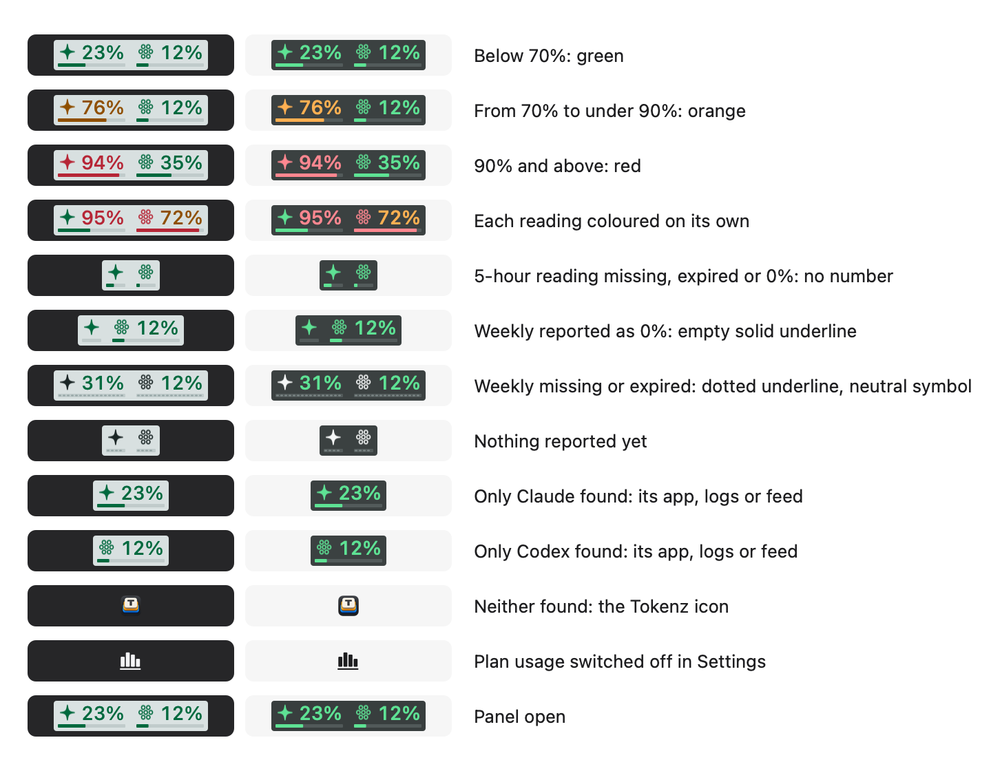</p>

<p align="center">
  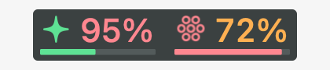
  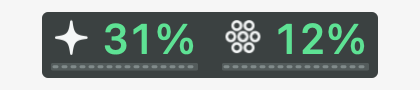
  <br><sub>Each reading coloured on its own, and no current weekly reading: dotted, not empty.</sub>
</p>

- The number is hidden when the 5-hour reading is missing, expired, or rounds to zero, and the item shrinks to fit.
- A weekly reading of zero is an empty solid underline. A missing or expired weekly reading is a dotted underline with a neutral symbol. One period never stands in for another.
- The group has its own background: dark in a light menu bar, pale in a dark one.
- Hover for exact percentages, reset times and when each was reported.

A provider appears when its desktop app (Claude, or ChatGPT/Codex) is installed, found by bundle identity, or when Tokenz finds its session logs or plan feed, so the command-line tool alone is enough. With neither found, the menu bar shows the Tokenz icon, and the panel and Settings stay available. Turn plan usage off in Settings for a chart symbol alone.

## What it tracks

- Claude Code: local `~/.claude/projects/**/*.jsonl`, including agent sessions.
- Codex: local `~/.codex/sessions/**/*.jsonl`, including desktop and CLI sessions that write this format.
- Today, seven days and the **last 30 days**, in the Mac's timezone. The rolling views include today and the previous 6 or 29 calendar days.
- Input, output, cache reads and Claude cache writes. Input includes cache reads and writes; Codex reasoning tokens are already included in output. Total = input + output.
- Plan percentages and reset dates as last reported: by Codex in its logs, by Claude Code through the status line. Expired windows show "Awaiting update" rather than an assumed reset value.
- An activity chart for the selected period: hourly for Today, daily for seven or 30 days. Hover a bar for exact totals. CSV export gives daily totals for the last 30 days.

<p align="center">
  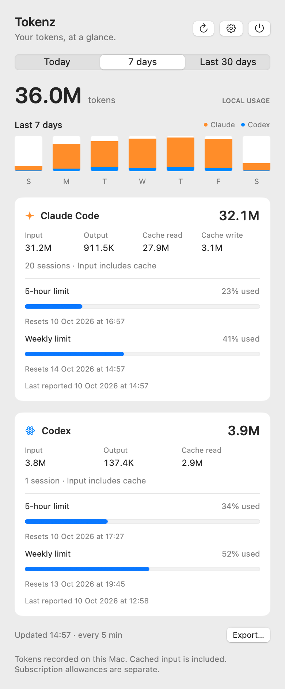
  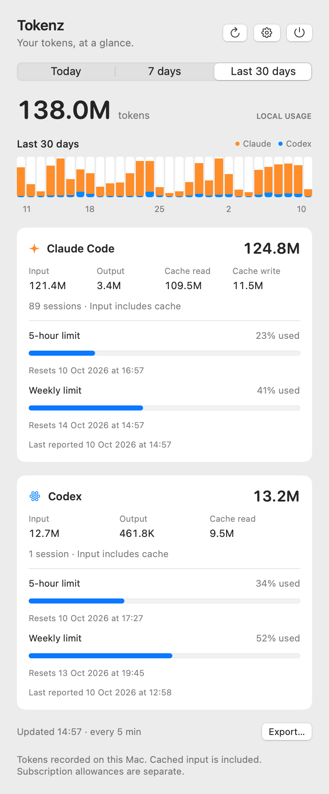
</p>

<p align="center">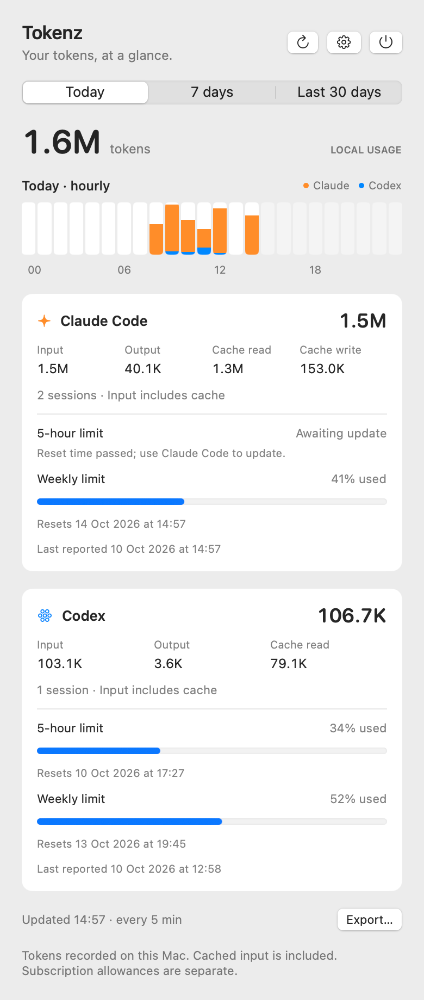</p>

Token totals are locally observed usage, not a billing statement. claude.ai chats, sessions on other machines, cloud-only Codex sessions and logs either tool has already deleted are outside the counters. Plan percentages are the providers' own account limits and are separate from local totals. If you use custom configuration folders, choose the matching `projects` or `sessions` folder in Settings. Archived Codex logs outside `sessions` are counted only if you choose a parent folder containing both.

The parser counts each Claude message once across content blocks and copied transcripts, derives Codex increments from cumulative counters, and skips copied Codex history by its original timestamp and counters. The first record of a resumed or forked Codex log uses `last_token_usage`, so inherited history is not counted again. The log formats are internal to each tool and may change; records Tokenz does not recognise are ignored.

## Privacy and performance

Tokenz reads the session folders, the Claude percentage file and Claude's `settings.json`. Apart from a CSV you export, it writes nothing unless you ask it to set up the status line, and then only its script and `settings.json`, which it backs up first. It never reads authentication files, sends network requests or stores conversation content; `scripts/test.sh` fails if networking code appears. Usage numbers are held in memory. The first scan reads recent files; later scans read only appended lines, **every five minutes** and on wake, on opening the panel or on refresh. An unfinished line waits until its writer completes it. Missing or unreadable folders are shown as such. Preferences live in standard macOS user defaults. CSV export contains only daily token totals.

<p align="center">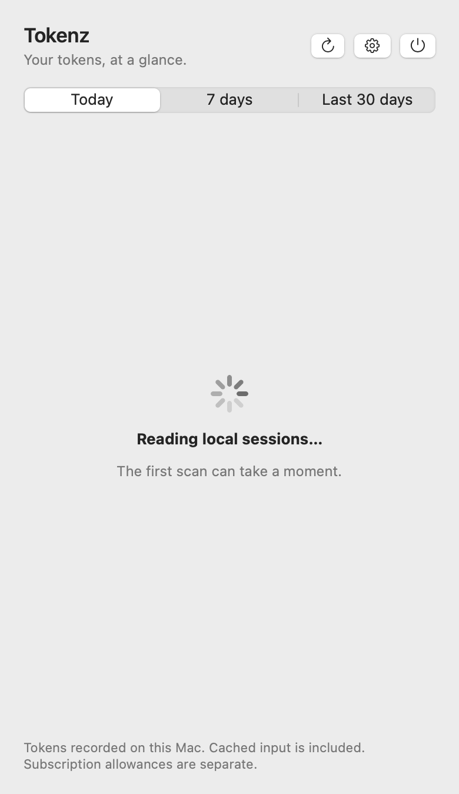</p>

## Develop

Requires the Swift 6 toolchain (Xcode or its command line tools).

```sh
./scripts/test.sh
./scripts/build.sh
open dist/Tokenz.app
```

Or `open Tokenz.xcodeproj`: the Tokenz scheme builds, runs and tests (⌘U). The Swift package is the source of truth; `Tokenz.xcodeproj` is generated from `project.yml` with [XcodeGen](https://github.com/yonaskolb/XcodeGen) and committed, so it opens without tooling. Regenerate after editing the spec or adding a source file. Signing is automatic with the team in `Local.xcconfig`, gitignored; `Signing.xcconfig` explains the one line.

Set `TOKENZ_BUILD_DIR` to keep build output outside the repository. A run outside the app bundle finds the status-line script through `TOKENZ_STATUSLINE_SCRIPT=scripts/tokenz-statusline.sh`. Read local counts without the UI, using the folders and feed chosen in Settings:

```sh
dist/Tokenz.app/Contents/MacOS/Tokenz --diagnose
```

`open dist/Tokenz.app --args --show` opens the menu bar panel; `--preview` opens the same view in a regular window. Local builds are ad-hoc signed; other Macs need a build signed with a Developer ID and notarised.

Sources: [Claude Code status line](https://code.claude.com/docs/en/statusline) (the `rate_limits` fields), [Claude Code costs](https://code.claude.com/docs/en/costs), [Codex app-server](https://learn.chatgpt.com/docs/app-server) (rate-limit concepts; the session-log format Tokenz reads is not documented).

## Contributing

See [CONTRIBUTING.md](CONTRIBUTING.md) for setup, project layout, validation and pull request guidance.

## License

Tokenz's code, documentation and app artwork are licensed under the [MIT license](LICENSE).
